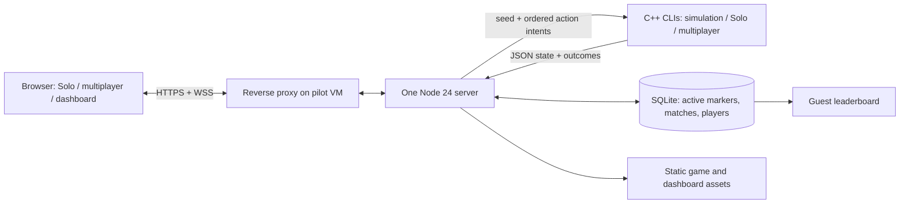
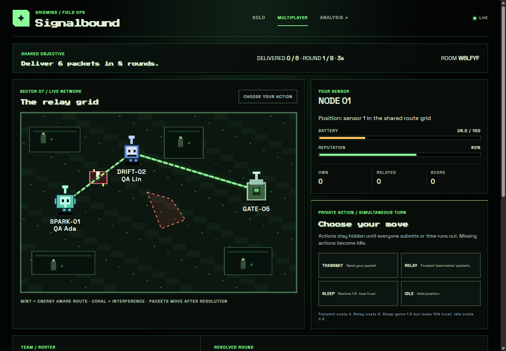
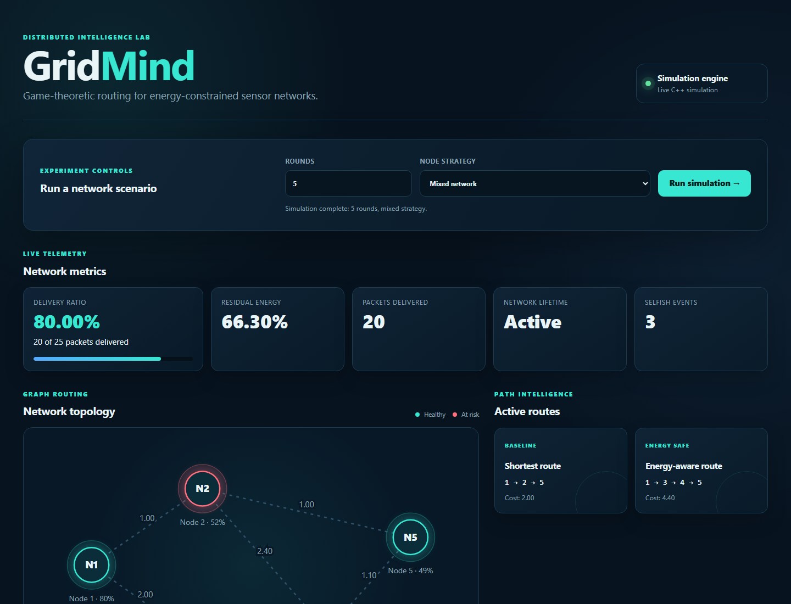
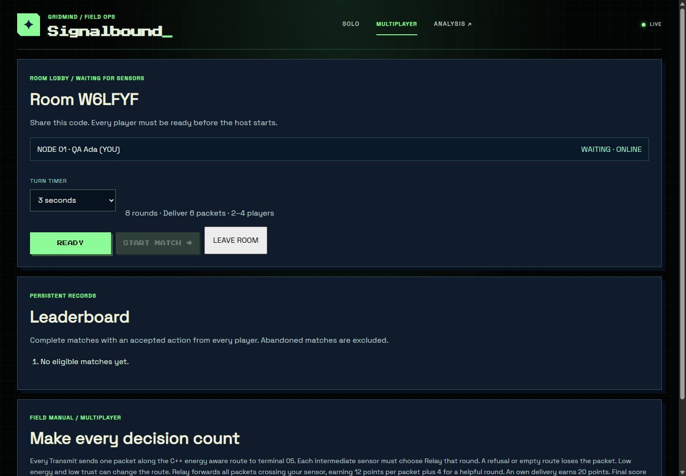
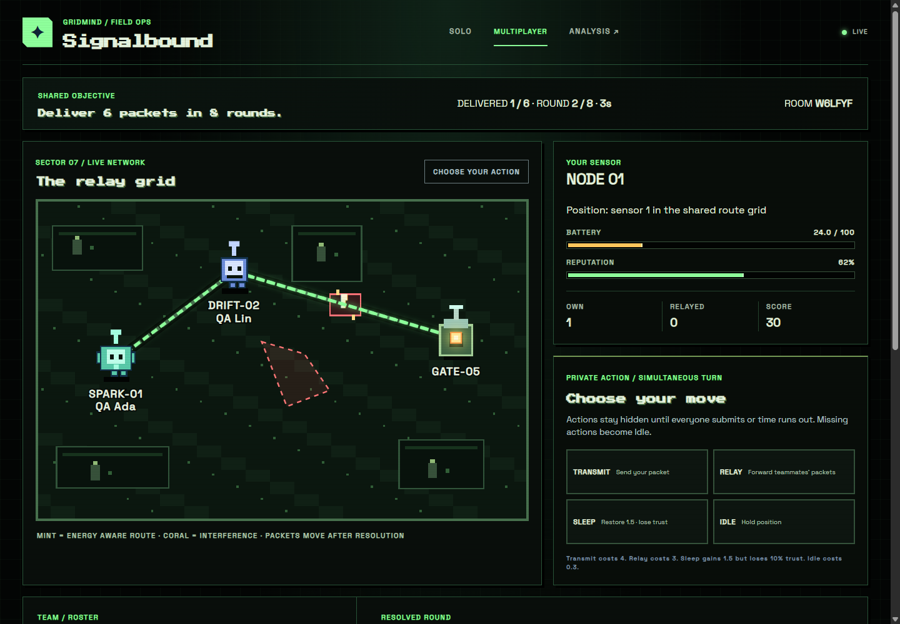
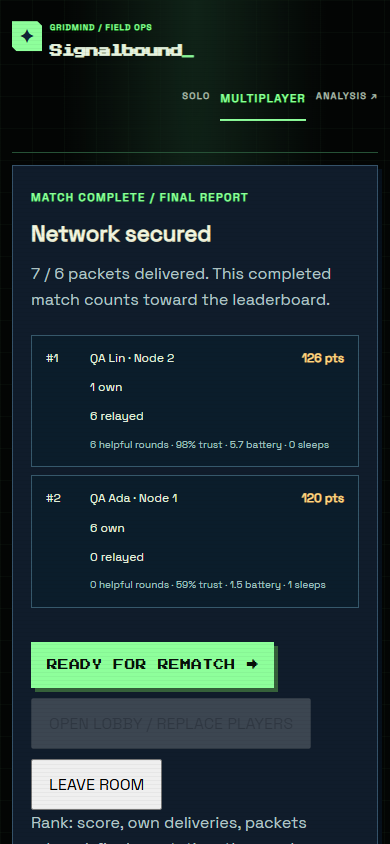

# Signalbound
## A technical report on energy, cooperation, and routing in a playable sensor network

**Project state:** `phase-6`, commit `c60da0e` · **Report date:** 25 October 2026
**Scope:** implemented software and local evidence. No OCI deployment or tenancy-specific plan has occurred.

> **Reading guide.** Signalbound contains three related but distinct models. **Solo** is an eight-round game against C++ AI. **Multiplayer** is an eight-round, two-to-four-person simultaneous game. **Dashboard** is a configurable batch simulation for analysis. They share lower-level C++ node, utility, and graph code, but their packet accounting and scores differ. A figure or number in this report is labelled with its mode.

## Abstract

Wireless sensor nodes operate on limited energy and often rely on other nodes to forward their data. A path with the smallest sum of link weights can cross a depleted or uncooperative relay; a nominally short route may therefore fail to deliver. Signalbound turns this tension into an inspectable game. Players choose when to transmit their own packet, relay someone else's, sleep to recover, or idle. The C++ engine computes energy and reputation effects, routes, packet outcomes, and scores; a Node server coordinates guests and persists completed multiplayer matches; the browser renders the decisions and consequences. Solo offers deterministic AI profiles and next-action previews. Multiplayer hides submitted choices until all players act or a deadline expires. A separate dashboard compares routes, strategies, and finite-horizon planning. The implementation is an educational, stylized network model, not a radio protocol or a validated estimate of physical-network performance. Local tests, browser QA, an emulated Linux Arm release, and a local TLS/WSS operations rehearsal support the claims below. An OCI deployment remains untested.

## 1. Problem, objectives, and scope

Sensor-network design must account for constrained power, multi-hop communication, topology, and node cooperation [R1]. Choosing a route solely by its physical link-weight sum ignores the condition and behavior of intermediate nodes. A low-cost node can have little energy or repeatedly decline relay work. Conversely, routing only around weak nodes can spend more link cost and does not itself make a human relay cooperate. Signalbound exposes both choices: the graph proposes a path, while the nodes' actions determine whether a packet actually arrives.

The project aims to make four ideas observable: (1) a selfish decision can conserve one node's battery while lowering shared delivery; (2) reputation and energy alter route preference; (3) a locally attractive action need not help the network over multiple rounds; and (4) a server must settle simultaneous human choices without revealing them early. The shipped scope includes a playable Solo mode, playable room-based multiplayer, a batch-analysis dashboard, local persistence and leaderboard, and a reviewable one-VM OCI deployment foundation. It does **not** implement real radios, congestion, cryptographic human identity, an OCI service, or multi-instance room coordination.

### Research context and positioning

Akyildiz et al. survey collaborative, power-aware wireless sensor networks [R1]. Heinzelman et al.'s LEACH distributes the energy burden by rotating cluster heads [R2]; Signalbound has no clustering and instead makes per-turn forwarding visible. Shah and Rabaey argue that always selecting the minimum-energy path can harm network lifetime and explore energy-aware route diversity [R3]. Signalbound uses a small deterministic additive route cost rather than their probabilistic scheme. Marti et al. study watchdog and pathrater responses to misbehaving ad hoc relays [R4]; Signalbound's threshold flag and reputation are teaching devices, not a verified intrusion detector. Dijkstra's shortest-path algorithm supplies the graph search [R5]. ns-3 is a general discrete-event research and education simulator [R6], while NetLogo supports agent-based learning [R7]. Signalbound's contribution is a compact, human-playable integration of routing, cooperation, visual feedback, and authoritative room play; the repository makes no research-novelty or network-fidelity claim.

## 2. System architecture



**Figure 1 — deployed shape, not a deployed service.** In local development the browser can connect directly to Node; the proposed pilot places Nginx in front of a loopback-bound server. `server.js` serves static pages and HTTP APIs; `room-server.js` owns room membership, pending actions, deadlines, and ordered WebSocket events; `match-store.js` applies migrations and transactions. Three native command-line programs form a narrow, replayable engine boundary. Browser code (`game/game.js`, `game/multiplayer.js`, dashboard scripts) presents engine output rather than calculating authoritative energy or score. The dashboard's batch simulation is separate from live packet resolution.

```mermaid
stateDiagram-v2
  [*] --> Lobby: create / join
  Lobby --> Lobby: ready, settings, leave
  Lobby --> Playing: host starts; 2–4 ready
  Playing --> Playing: accepted intents; all act or deadline; C++ resolves
  Playing --> Finished: round 8
  Playing --> Interrupted: server restart
  Playing --> Abandoned: two empty rounds with everyone absent
  Finished --> Lobby: rematch / reopen
  Interrupted --> Lobby: returning member reopens
  Lobby --> [*]: inactivity expiry
```



**Figure 2 — room lifecycle.** Only the host can change settings or start. A started roster stays assigned to its nodes. Active rooms live in one Node process; SQLite stores an active marker and member token hashes for restart recognition, but not a resumable turn checkpoint. Restart deliberately marks an active match interrupted and unranked, and a returning guest sees that reason. This avoids replaying an uncertain partially resolved round.

## 3. Model and algorithms

### 3.1 Node state and actions

A `SensorNode` has integer ID; energy **E** in [0,100]; reputation **R** in [0,1]; counts of relay requests, successful relays, and selfish decisions; and a cooperative or selfish AI strategy. Multiplayer's human nodes start at E=28 and R=0.60; Solo's node 1 starts at E=28 and R=0.55. The terminal is node 5. Display positions are rendering coordinates, not a coordinate-based radio propagation model. In both games, one selected action applies per node per round:

| Action | Energy | Reputation / delivery effect | Legality |
| --- | --- | --- | --- |
| Transmit | −4 | +0.02 if delivered, −0.03 if failed | E ≥ 4 |
| Relay | −3 | +0.06 if it forwarded a delivered packet | E ≥ 3; Solo only on even rounds |
| Sleep | +1.5 | −0.10, increments selfish decisions; packet opportunity expires | Always |
| Idle | −0.3 | No trust benefit; packet opportunity expires | Always |

Energy and reputation are clamped after the action. A **multiplayer relay with no successful packet** still spends 3 energy but gets no reputation change; the general `GameTheoryEngine::applyActionResult` instead applies −0.08 to a failed Relay in batch/Solo contexts. This mode-specific distinction matters when interpreting graphs and score. Multiplayer Relay can forward more than one successful packet in a round. Sleep increments the engine's relay-request counter even if no route currently needs that node; consequently the threshold flag is a simplified behavior signal, not an independently observed radio request log.

### 3.2 Utility, strategy, and selfish-node flag

The utility evaluator scores an AI/planner action using decision context **D** (delivery reward), **C_T**=4, **C_R**=3, **Q** (sleep recovery), and **L** (delay penalty). Let **w**=1 for cooperative strategy and 0.45 for selfish strategy; **p** is reputation, **e** energy. Transmit and Relay are assigned −1000 when their prerequisites fail. Otherwise the code evaluates:

```text
U(T) = D·w + 1.5p − C_T − L                       [own data and e ≥ C_T]
U(R) = D·w + 3p − C_R − (3.2 if selfish else 0.4) [relay requested and e ≥ C_R]
U(S) = Q·(2 if selfish else 1) + 0.12·max(0,40−e)
       − (4p if relay requested else 0.5)·(0.45 if selfish else 1)
U(I) = 0.8 − (2p if relay requested or own data else 0)
```

`chooseBestAction` selects the maximum in **Transmit, Relay, Sleep, Idle** order, so an exact tie favors the earlier action. Solo AI uses D=8 normally and D=30 for a requested relay during deterministic signal surge `(seed + round) mod 4 < 2`; it has no own packet in that context. The strategy label changes utility weighting; it does not prohibit cooperation. The engine flags a node only if relay requests ≥3, successful-relay ratio <0.45, E>30, and R<0.55. This is a rule-based indication for the dashboard, not a probability of maliciousness.

### 3.3 Graph routing and worked example

`NetworkGraph` stores undirected, nonnegative links in a map-backed adjacency list and runs Dijkstra with a min-priority queue. The ordinary traversal cost is link weight **wᵢⱼ**. For an energy-aware step into intermediate node **j**, it is:

```text
c(i,j) = wᵢⱼ + 0.08·max(0,50−Eⱼ) + 6·max(0,0.70−Rⱼ)
```

The destination receives no node penalty. A strict `<` relaxation preserves the first discovered predecessor on an exact equal cost; queue/map traversal order can influence an equal-cost route, so the code does not promise a semantic tie preference. Time is O((V+E) log V) for heap search with these containers; graph storage is O(V+E). Routes are recomputed from current powered nodes and the round's links. Solo additionally adds **6 per edge touching a selfish intermediate node** before the energy-aware search. Both games perturb one seeded link weight by +2 each round; the dashboard's fixed batch topology is described below.

**Illustrative route calculation from the dashboard's mixed five-round result.** The six-link graph has 1–2=1, 2–5=1, 1–3=2, 3–4=1.3, 4–5=1.1, and 2–4=2.4. The physical route 1→2→5 costs **2.0**. At the evaluated node state, low energy and reputation at node 2 make the energy-aware result **1→3→4→5**, base link sum **4.4**. The example demonstrates route preference, not a measured radio success rate. The dashboard output records both paths; the exact additive adjusted costs depend on the node state after the five simulated rounds.

### 3.4 Planning and the three scores

The dashboard compares a one-step greedy utility choice to a memoized finite-horizon dynamic program of at most 20 rounds. The DP state key includes round, energy rounded to tenths, reputation rounded to hundredths, relay requests, successful relays, and selfish decisions. It explores up to four actions per reachable state; for **S** reachable states over horizon **H**, time is O(4S) (with map lookup overhead) and stored paths can take O(HS). Greedy evaluates four actions per round, O(4H). Both use a simplified forecast that treats feasible Transmit/Relay as delivered; they are **planning illustrations**, not an exact opponent policy for live multiplayer. The default five-round dashboard case gives both five Relays, utility 38, and final planner energy 58, so the report makes no claim that DP wins that sample.

The dashboard counts attempted and delivered *action operations* across nodes in its batch run; it does not require a simultaneous end-to-end chain. Solo increments shared delivery for a successful player Transmit or even-round Relay. Its final score is rounded from `100·delivered + 20·(delivered/attempted) + E + 50R − 10·selfishDecisions + 35·ownDelivered`. Solo wins at round eight with ≥6 deliveries, R≥0.60, and positive E. Multiplayer delivers a Transmit only if a powered route exists and **every intermediate human node selected Relay in that same round**. Its network wins at ≥6 delivered packets after eight rounds. Player score is recalculated as `20·ownDelivered + 12·packetsRelayed + 4·cooperativeRelayRounds + floor(10R) + floor(E/5) − 5·selfishSleeps`. This couples self-interest to helping others: an immediate Transmit can block a neighbor's packet that needed one's Relay, while perpetual Relay wastes energy when no traffic uses that node. Results rank score, then own deliveries, relayed packets, reputation, and lower node ID. Leaderboard ties additionally prefer earlier completion before node ID.

## 4. Gameplay and interaction

### 4.1 Solo

The title screen offers **Ally Grid** (cooperative AI), **Fault Line** (mixed AI), and **Blackout** (selfish AI). Node 1 is controlled by the player; nodes 2–5 follow the C++ utility model. The seeded map shows links, interference, route changes, moving packets, energy/reputation feedback, and plain-language delivery or failure. Before confirming an action, the browser shows the C++ replay-derived next-turn preview, including legality and expected immediate effects. Keys **1–4** select Transmit, Relay, Sleep, Idle; **Enter** confirms; **P** pauses; **Escape** resumes. Mouse/touch controls also work. A neighbor relay request for the player appears on even rounds. A run has eight rounds; the URL may carry seed and profile. Optional synthesized effects and reduced-motion handling support presentation, but audio is not required for the rules.

### 4.2 Multiplayer

A guest creates or joins a six-character room. The lobby displays names, assigned nodes 1–4, ready states, a configurable 20–90-second turn timer (30 by default), and a host-controlled start. At least two guests and an all-ready roster are required. Each human owns one sensor; terminal 5 is not a player. During a round, each client privately submits one legal action. Other clients see only whether that node has submitted. The server resolves when all accepted intents arrive or the deadline fills missing nodes with Idle. Resolution broadcasts actions, packet routes, moving packets, per-node energy and reputation changes, and failure reasons such as “Node 2 did not relay this packet.” A disconnected node retains its assignment; refresh with its browser token reclaims it. The last state snapshot and ordered events let a client recover after a missed event. The results screen shows network outcome, player contributions and ranking, with rematch/reopen flow. A separate guest-based leaderboard lists eligible individual match performances.



**Figure 3 — recorded browser QA, desktop multiplayer.** Captured before this report pass by the repository's Chrome QA script; illustrative of the actual UI, not a new measurement. The 3-second timer visible in these QA screenshots is a local test override; ordinary settings accept 20–90 seconds. The lobby and result captures appear in Appendix C.

### 4.3 Analysis dashboard

`/dashboard` runs parameterized batch scenarios and displays delivery ratio, energy, selfish-event observations, routes, strategy and planner comparisons. It is useful for discussing why the lower link-weight path can differ from the energy-aware path. Its delivered-action count must not be interpreted as the live game's end-to-end packet count.



**Figure 4 — recorded dashboard view.** Source: repository `docs/screenshots/dashboard-desktop.png`, copied into this report's assets.

## 5. Server, protocol, records, and operations

The server issues a random 256-bit room-scoped guest bearer token; the browser stores it in local storage, while the server holds a SHA-256 hash. The token identifies a **browser session**, not a person. Room codes are join handles, not secrets. HTTP creates/joins rooms and reads health, matches, and leaderboard; `/ws` carries version-1 room messages. A client `hello` includes room ID, token, and optional `afterSeq`. The server always returns a current snapshot; ordered envelopes contain version, room ID, match ID, sequence, round, event type, and data. Action intents include match and round but no node ID, energy, score, reputation, or delivery total. Membership maps the token to the assigned node. The server validates shape, size, room/match/round, host rights, current legality from C++ output, and one accepted action per player per round. It serializes each room's resolutions and invokes the C++ multiplayer CLI with a seed and ordered `T/R/S/I` round record. A failed engine invocation leaves the turn pending rather than publishing partial resolution.

SQLite migrations create completed `matches`, `match_players`, `active_rooms`, and migration history. A completed match and its players are inserted transactionally under a unique match ID; the active marker removal shares the transaction. The record stores the seed and action rows so the same engine version can replay a disputed result. A completed entry is leaderboard-eligible only if at least two distinct guests finished eight rounds, each supplied at least one accepted action, and there was no two-round streak without accepted actions. Ineligible/abandoned results remain audit records without leaderboard credit. On restart, started matches are marked interrupted and **unranked**; returning members can see the reason and reopen. Lobby-only rooms expire. With all members disconnected and no real actions for two rounds, the match becomes abandoned rather than trapping an empty room.

Public bounds include exact production Origin checks for mutating HTTP and WebSocket traffic; loopback-only trust of forwarded proxy host/protocol; 16 KiB HTTP bodies, 4 KiB WebSocket messages, 30 WebSocket messages per 10 seconds per connection, and 20 room-create/join requests per IP per minute. The server caps 200 rooms and 64 pending unauthenticated sockets and times unauthenticated sockets out after 10 seconds. Errors are stable and do not reveal database paths or tokens; logs omit bodies and bearer values. `/api/live` tests process availability; `/api/health` exercises the three CLIs and SQLite integrity/write readiness. These controls bound ordinary misuse; they do not provide account-level anti-cheat or edge DDoS protection.

The proposed OCI pilot is one Ubuntu 24.04 aarch64 Ampere A1 Flex VM, one Node 24.21.0 process, an Nginx TLS/WSS proxy, a 50 GB boot volume, and a separate 50 GB persistent data volume. The app listens on loopback; proposed ingress is 80/443 publicly and SSH 22 only from a trusted CIDR. `systemd` restarts the service and requires the data mount. `scripts/build-release.sh` creates an Arm64 runtime-only tarball with three ELF CLIs, server/UI assets, migrations, service/proxy templates, and SHA-256 manifests. SQLite backup uses Node's online backup API, followed by verification and offline restore; copying a live WAL database file alone is unsafe. The VM and its attached database are one failure domain. The Terraform configuration is a **reviewable proposal**, not an applied plan for an actual tenancy.

## 6. Testing and evaluation

### 6.1 Reproducible checks and measured observations

The native test launcher compiles/runs routing, utility/planning, metrics, simulation, Solo, balance, and multiplayer suites. `npm test` adds Node HTTP/WebSocket, security, persistence, backup, dashboard, and browser-script syntax checks. `npm run check` builds the three CLIs. In the earlier Arm rehearsal, a clean archive under Docker Desktop x86 + QEMU `linux/arm64` built the three AArch64 ELFs and passed native and Node checks; the subsequent clean release bundle passed per-file SHA verification and extraction smoke checks. This is **emulated Arm execution**, not an OCI A1 hardware test. The Arm CI workflow targets `ubuntu-24.04-arm` but has not been triggered by this work.

| Observation | Actual recorded value | Meaning / limit |
| --- | --- | --- |
| Batch default mixed, 5 rounds | 25 attempted operations, 20 delivered, 80% ratio, 66.30 average residual energy, 3 selfish-event observations | Dashboard action-level simulation; `lifetimeRound = −1` means no depletion by round 5. |
| Batch route comparison | shortest 1→2→5, cost 2.00; energy-aware 1→3→4→5, base cost 4.40 | Routes from batch output, not a delivery experiment. |
| Batch planner comparison | DP and greedy: five Relay actions, utility 38, energy 58 | One context; no general DP advantage shown. |
| Solo seed sweep | seeds 0–99, three AI profiles; at least one winning candidate plan in each sampled start; 600/500/100 winning plans out of 600 candidate plans per profile | Automated finite candidate family, not exhaustive strategies or human difficulty. |
| Earlier Solo Chrome QA | seed 17 mixed, six of eight packets, score 734 for two Transmits, four Relays, two Idles; eight Idles lost | Prior browser run at desktop and 390 px. |
| Earlier local TLS/WSS rehearsal | two Node clients completed a match with seven of six target deliveries; restart interrupted an active rematch without ranking it; restored DB had one completed match and two leaderboard rows | Local proxy and emulated Arm process, not two new browser sessions and not public OCI. |

The previous multiplayer browser QA used two independent Chrome sessions, included refresh mid-match, a timeout, result, and rematch, and checked 1440-pixel desktop and 390-pixel mobile widths. Its screenshots are included here. The operations rehearsal's two-client WSS result used **Node clients** behind local HTTPS/WSS; it must not be presented as a public two-device or browser WSS test. This report pass only rechecks relevant source, documentation, images, and output claims; it does not rerun the full app suite because it changes no gameplay code.

The local operations rehearsal further exercised release extraction, health smoke, application restart, completed-match persistence, a database-consistent online backup and isolated restore, and a release switch and rollback on the same data mount. The restart during a live rematch showed “interrupted” to returning members and did not create an eligible result. The runbook gives the exact container, TLS proxy, smoke, backup, restore, upgrade, and rollback commands. These observations support local operational feasibility, not availability, performance, billing, or compatibility on an actual OCI VM.

### 6.2 Limits of the evidence

The model uses five nodes, fixed small topologies, deterministic link interference, abstract energy units, and simple reputation. No physical-layer loss, MAC contention, bandwidth, propagation, mobility, clock drift, or experimental sensor measurements are represented. The seed sweep checks reachable wins for one plan family, not optimal play. Browser QA was reported for Chrome on Windows, not a device/browser compatibility matrix. The exact performance and lifecycle on OCI A1 hardware, tenancy-specific Terraform changes and cost, public DNS/TLS, and public two-device WSS play remain open.

## 7. Security, deployment readiness, and future work

Guest tokens survive refresh only while browser storage survives. A copied token can impersonate that guest, and names do not establish identity; leaderboard integrity is at the match-record level, not at the person level. A single Node process holds active room state. Running a second process would split rooms and deadlines; multi-instance scaling requires shared coordination and an exactly-once resolution design. A restart interrupts active play deliberately. SQLite on one mounted volume survives process restart but not a destroyed or failed failure domain unless a verified off-VM backup exists. Production also needs monitoring, certificate renewal, OS updates, bounded resource use, and an incident/restore procedure as detailed in the operator runbook.

The OCI code and operator templates cover VCN/subnet, gateway, security group, one A1 Flex VM, attached storage, Nginx, systemd, health, release, and backup. Formatting/validation and local operations have been exercised, but **no tenancy-specific Terraform plan, OCI A1 hardware execution, cloud resource creation, push, DNS configuration, or deployment has occurred**. Eligibility for Always Free does not guarantee capacity or zero charges [R8, R9]. An actual gate must inspect the home-region tenancy, current limits, selected Arm image, availability domain, ingress, public IP, storage, and projected costs before an authorized apply. Azure for Students or another single VM could run the same Arm-compatible or rebuilt C++/Node app, SQLite data mount, systemd service, and TLS/WSS proxy, but would need provider-specific network, image, disk, firewall, DNS, and cost configuration; OCI Terraform is not portable across providers.

Reasonable future extensions are durable player accounts with recovery and abuse controls, transactional active-room checkpoints or a shared coordinator, resilient off-host backups, richer traffic and topology scenarios, a more faithful radio/network model, broader accessibility and browser testing, and controlled learning studies. None is claimed as shipped.

## 8. Conclusion

Signalbound makes the gap between a chosen route and an actually delivered packet visible. A small C++ model gives explicit, replayable outcomes; Solo AI and preview let one learner experiment; simultaneous multiplayer makes cooperation consequential; the dashboard exposes route and planner comparisons. Local tests and rehearsals establish a functioning software foundation. The public pilot remains a separate, account-dependent deployment and hardware verification step.

## References

All external sources below were checked on **25 October 2026**. Project-specific implementation claims are traced in [`report-evidence.md`](report-evidence.md).

- **[R1]** Akyildiz, I. F., Su, W., Sankarasubramaniam, Y., & Cayirci, E. (2002). “Wireless sensor networks: a survey.” *Computer Networks*, 38(4), 393–422. DOI: [10.1016/S1389-1286(01)00302-4](https://doi.org/10.1016/S1389-1286(01)00302-4). [Author PDF](https://ianakyildiz.com/bwn/surveys/sensornets.pdf).
- **[R2]** Heinzelman, W. R., Chandrakasan, A., & Balakrishnan, H. (2000). “Energy-Efficient Communication Protocol for Wireless Microsensor Networks.” *Proceedings of the 33rd Hawaii International Conference on System Sciences*. DOI: [10.1109/HICSS.2000.926982](https://doi.org/10.1109/HICSS.2000.926982). [MIT-hosted paper](https://pdos.csail.mit.edu/archive/decouto/papers/heinzelman00.pdf).
- **[R3]** Shah, R. C., & Rabaey, J. M. (2002). “Energy Aware Routing for Low Energy Ad Hoc Sensor Networks.” *IEEE Wireless Communications and Networking Conference*, vol. 1, 350–355. DOI: [10.1109/WCNC.2002.993520](https://doi.org/10.1109/WCNC.2002.993520). [UC Berkeley-hosted paper](https://www-inst.eecs.berkeley.edu/~ee228a/fa03/228A03/sensor_networks/shah_rabaey.pdf).
- **[R4]** Marti, S., Giuli, T. J., Lai, K., & Baker, M. (2000). “Mitigating Routing Misbehavior in Mobile Ad Hoc Networks.” *Proceedings of MobiCom 2000*. DOI: [10.1145/345910.345955](https://doi.org/10.1145/345910.345955). [Author paper mirror](https://shiftleft.com/mirrors/www.hpl.hp.com/personal/Mary_Baker/publications/mitigating.pdf).
- **[R5]** Dijkstra, E. W. (1959). “A note on two problems in connexion with graphs.” *Numerische Mathematik*, 1, 269–271. DOI: [10.1007/BF01386390](https://doi.org/10.1007/BF01386390). [University record](https://research.tue.nl/en/publications/a-note-on-two-problems-in-connexion-with-graphs/).
- **[R6]** ns-3 Project. “What is ns-3?” [Official project description](https://www.nsnam.org/about/what-is-ns-3/).
- **[R7]** Wilensky, U. (1999). *NetLogo*. Center for Connected Learning and Computer-Based Modeling, Northwestern University. [Official project](https://www.netlogo.org/about/).
- **[R8]** Oracle. “Always Free Resources.” [OCI documentation](https://docs.oracle.com/en-us/iaas/Content/FreeTier/freetier_topic-Always_Free_Resources.htm).
- **[R9]** Oracle. “Arm-Based Compute.” [OCI documentation](https://docs.oracle.com/en-us/iaas/Content/Compute/References/arm.htm).

## Appendix A. Exact local commands

From the repository worktree with **Node 24.21.0 or newer for local development** and a C++11 `g++` on `PATH`:

```sh
npm run check
npm test
npm start
# Visit http://127.0.0.1:3000/ , /multiplayer , /dashboard
./simulation_cli.exe --rounds 5 --strategy mixed
./game_cli.exe --seed 17 --profile mixed --actions ''
./multiplayer_cli.exe --seed 17 --players 2 --rounds TR,II
node scripts/smoke.js http://127.0.0.1:3000
```

The `.exe` suffix is historical; an Arm release contains Linux AArch64 ELF executables. On Windows PowerShell, use `./...` or `.\...` as appropriate. The exact Docker/QEMU build, local TLS/WSS playthrough, backup/restore, and rollback commands are in [`oci-pilot-runbook.md`](oci-pilot-runbook.md), sections “Build and release on Arm” and “Local Arm and operations rehearsal.” For the proposed OCI IaC, `cd infra/oci && terraform fmt -check && terraform init -backend=false -input=false && terraform validate` is a local structural check, **not** a tenancy-specific plan.

## Appendix B. Interface examples and repository map

```json
POST /api/game
{"schemaVersion":2,"seed":17,"profile":"mixed","actions":["TRANSMIT","RELAY"]}

POST /api/rooms
{"name":"Ada"}

WebSocket client intent (illustrative envelope; use the live room/match IDs):
{"v":1,"type":"action","roomId":"ABC234","matchId":"<match-id>","round":1,"action":"TRANSMIT"}
```

The Solo API replays all ordered actions; a multiplayer action is a **single private intent** for the member represented by the guest token. Consult the version-1 contract in `docs/multiplayer-design.md` and validation in `room-server.js` for exact accepted fields; the placeholder above is illustrative, not a captured packet.

| Path | Role |
| --- | --- |
| `src/` | C++ node/utility, graph, planner, batch, Solo and multiplayer engines/CLIs |
| `server.js`, `room-server.js`, `match-store.js` | HTTP/WebSocket boundary, room state, SQLite records |
| `game/`, `dashboard/` | browser play, original code-native pixel art and analysis UI |
| `tests/`, `scripts/` | native/Node checks, QA, backup, smoke, release packaging |
| `migrations/`, `deploy/`, `infra/oci/` | schema, service/proxy templates, proposed OCI infrastructure |
| `docs/` | design, balance, runbook, screenshots, this report and evidence map |

## Appendix C. Visual record and terminology



**Figure 5 — recorded lobby:** assigned node, name, readiness control and disabled start button while waiting for another guest in the earlier desktop Chrome QA. The 3-second timer is the local QA override.



**Figure 6 — recorded resolution:** packet path and round feedback after action revelation.



**Figure 7 — recorded 390-pixel results view:** mobile layout from the earlier browser QA; no claim about physical-device testing.

**Terminal** means node 5, the packet destination. **Interference** is a seeded +2 link-weight perturbation, not simulated RF noise. **Reputation** is an engine scalar that affects energy-aware routes and some scores, not a cryptographic trust certificate. **Network outcome** is a shared eight-round delivery threshold; **individual score** ranks contributions within that match. **Guest token** is a browser-held bearer credential for a room member. **Replay** means rerunning the same C++ engine version with recorded seed and ordered actions.
